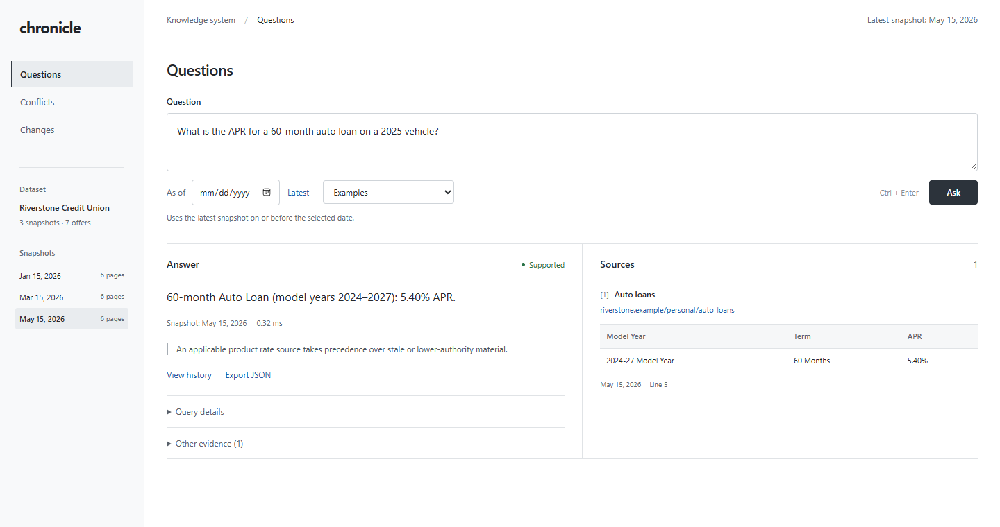

# Chronicle

A knowledge system for answering questions from dated website snapshots, with
source citations, conflict resolution, and historical queries.



## Requirements

Python 3.11 or newer with SQLite FTS5 support. No third-party Python packages or
API keys are required.

## Run

The included sample dataset contains three snapshots of a fictional credit union:

```sh
python -m chronicle --demo serve
```

The interface is available at http://127.0.0.1:8765. It supports questions,
source inspection, answer history, conflict filtering, and snapshot comparisons.

A participant ZIP, extracted kit, or snapshot directory can be loaded directly:

```sh
python -m chronicle --snapshots /path/to/participant.zip serve
python -m chronicle --snapshots /path/to/snapshots ask "What are the current mortgage rates?"
```

The assignment dataset is excluded from the repository. Source URLs are retained
for citations; answers use the supplied snapshots without fetching the live website.

## Command-line interface

```sh
python -m chronicle --demo ask "What is the APR for a 60-month auto loan on a 2025 vehicle?"
python -m chronicle --demo ask "What is the APY for the 12-month certificate?" --as-of 2026-01-31
python -m chronicle --demo conflicts
python -m chronicle --demo changes
```

The index runs in memory by default. The `--database` option persists it between runs:

```sh
python -m chronicle --snapshots /path/to/participant.zip --database /path/to/knowledge.sqlite snapshots
python -m chronicle --database /path/to/knowledge.sqlite serve
```

Persisted indexes contain source material and require rebuilding after extraction
rules change. Database files and exported traces are excluded by `.gitignore`.

## Python interface

`solution.py` defines `build()`, which returns the knowledge system:

| Method | Behavior |
| --- | --- |
| `ingest(snapshot)` | Parse and store a complete website snapshot. |
| `answer(question, as_of=None)` | Return an answer, citations, confidence flag, and optional conflict note. |
| `conflicts()` | Return competing values, their sources, and resolution reasons. |

The evaluator's boundary dataclasses are used when available. Compatible local
definitions support standalone operation.

The public evaluation command runs from the participant kit directory:

```sh
python harness/run_eval.py --submission /path/to/chronicle --eval eval/public_eval.jsonl --out /path/to/results
```

## Tests

```sh
python -m unittest discover -v
python scripts/audit_release.py
```

The 47 tests cover temporal isolation, tier selection, conflict handling, abstention,
source-value mutations, persistence, archive loading, and the HTTP API. CI runs on
Python 3.11 and 3.12 on Windows and Linux.

## Documentation

- [Design notes](NOTES.md): approach and tradeoffs.
- [Architecture](docs/ARCHITECTURE.md): data model, temporal rules, and limitations.
- [Evaluation](docs/EVALUATION.md): results, remaining misses, and reproduction commands.
